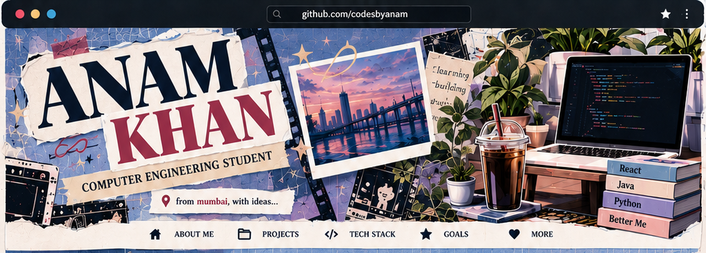

  
   
  
   
  MUMBAI, INDIA　/　COMPUTER ENGINEERING　/　STILL EXPLORING

  

hey, i'm anam — a second-year computer engineering student trying different corners of tech and figuring out what i want to get really good at.

right now that means building things, learning as i go, and occasionally spending way too long fixing one tiny bug. i haven't picked one lane yet, and i'm okay with that.

  

<table>
<tr>
<td width="50%" valign="top">

01 / SteamFuel
A website for a healthy steamed-food brand. I'm working on the digital experience — the look, the feel, and how the food gets presented.

WEB DESIGN · FRONTEND
</td>
<td width="50%" valign="top">

02 / Complaint Management System
A Java mini project about managing complaints and understanding how the pieces of an application fit together.

JAVA · APPLICATION LOGIC
</td>
</tr>
</table>

  WORK IN PROGRESS IS STILL WORK.

  

<table>
<tr>
<td width="50%" valign="top">

QUADRA — Health Guardian

Healthcare assessment project.

ON HOLD
</td>
<td width="50%" valign="top">

Webathon 3.0

Hackathon website project.

ON HOLD
</td>
</tr>
</table>

  
    
  
   
  DIFFERENT TOOLS, DIFFERENT COMFORT LEVELS. NO FAKE PERCENTAGES.

  

<table>
<tr>
<td align="center" width="33%">

MAKE

something small
</td>
<td align="center" width="33%">

FIGURE IT OUT

one bug at a time
</td>
<td align="center" width="33%">

DO IT AGAIN

a little better
</td>
</tr>
</table>

  
  still learning. still building. see you in the commits.

