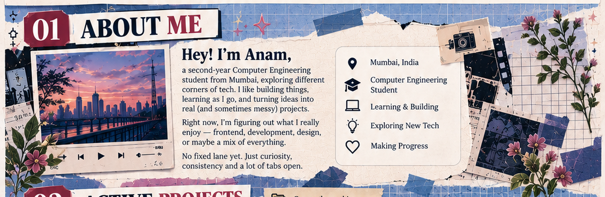
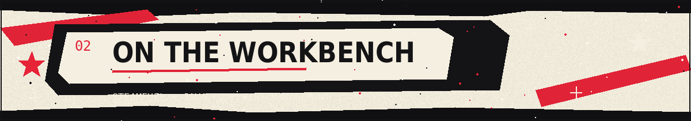
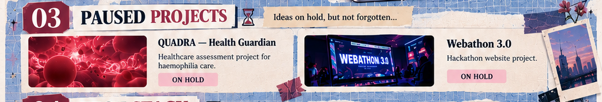
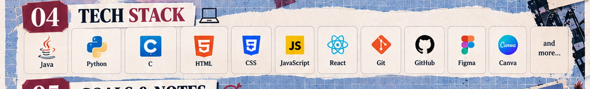
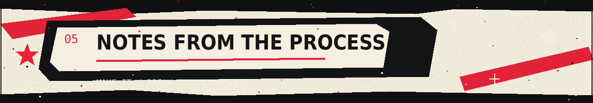

**COMPUTER ENGINEERING · MUMBAI, INDIA**

*Building things, breaking things, learning what works.*

[GitHub profile](https://github.com/codesbyanam) · [Browse my repositories](https://github.com/codesbyanam?tab=repositories)

---

<table>
<tr>
<td width="50%" valign="top">

[Find SteamFuel in my repositories →](https://github.com/codesbyanam?tab=repositories)

</td>
<td width="50%" valign="top">

[Browse my Java projects →](https://github.com/codesbyanam?tab=repositories)

</td>
</tr>
</table>

---

<table>
<tr>
<td width="50%" valign="top">

[Open the QUADRA repository →](https://github.com/codesbyanam/quadra-health-guardian)

</td>
<td width="50%" valign="top">

[Open the Webathon 3.0 repository →](https://github.com/codesbyanam/Webathon-3.0)

</td>
</tr>
</table>

---

  
  
  
  
  
  
  
  
  
  
  
  

Tools I use or am exploring—not a claim that I’ve mastered every one.

---

---

[See what I’m building on GitHub →](https://github.com/codesbyanam?tab=repositories)

