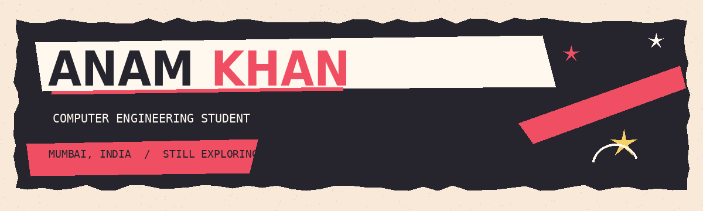
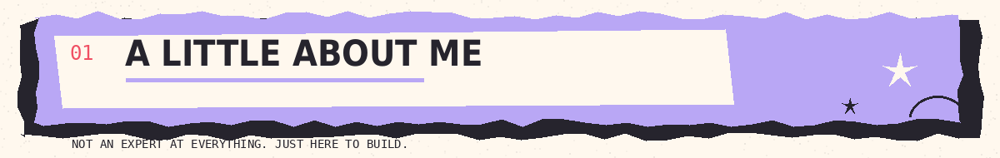
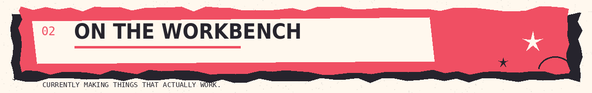
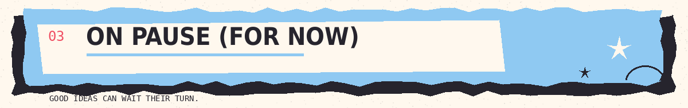
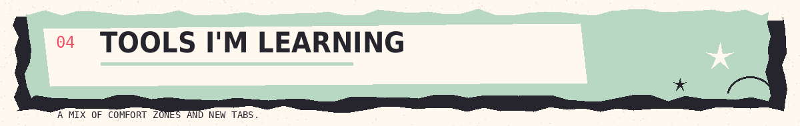
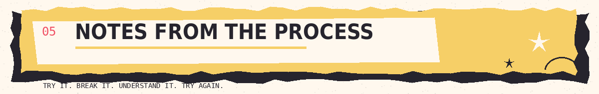

  

  <b>MUMBAI, INDIA</b> &nbsp; / &nbsp; COMPUTER ENGINEERING &nbsp; / &nbsp; STILL EXPLORING

---

  

hey, i'm **Anam** — a second-year computer engineering student at M. H. Saboo Siddik College of Engineering, Mumbai.

i like the part where an idea stops being just an idea and turns into something you can click, test, break, and make better. i'm exploring frontend, Java, and the bits of development that make an application feel complete.

i'm still learning. that is kind of the point.

  

<table>
  <tr>
    <td width="50%" valign="top">
      <b>01 / SteamFuel</b> 
      A startup concept for oil-free, steamed food. I'm working on the website's frontend and the way the brand and food are presented.
        <code>UI DESIGN</code> · <code>FRONTEND</code>
    </td>
    <td width="50%" valign="top">
      <b>02 / Complaint Management System</b> 
      A Java mini-project focused on recording and managing complaints, and understanding how application logic fits together.
        <code>JAVA</code> · <code>APPLICATION LOGIC</code>
    </td>
  </tr>
</table>

  

- **QUADRA — Health Guardian:** a haemophilia care assessment and support project.
- **Webathon 3.0:** a hackathon website project.

These are paused while I focus on current work. Not abandoned; just not the active tab right now.

  

`C` &nbsp; `Java` &nbsp; `Python` &nbsp; `HTML` &nbsp; `CSS` &nbsp; `JavaScript` &nbsp; `React` &nbsp; `Git` &nbsp; `GitHub` &nbsp; `Figma`

I'm more interested in understanding what I'm building than collecting logos. Some tools are familiar; others are still a work in progress.

  

| MAKE | FIGURE IT OUT | DO IT AGAIN |
|:---:|:---:|:---:|
| Start small. | Read the error properly. | Make the next version better. |

---

  <b>currently learning, building, and working it out.</b> 
  Find me on GitHub: <a href="https://github.com/codesbyanam">@codesbyanam</a>

